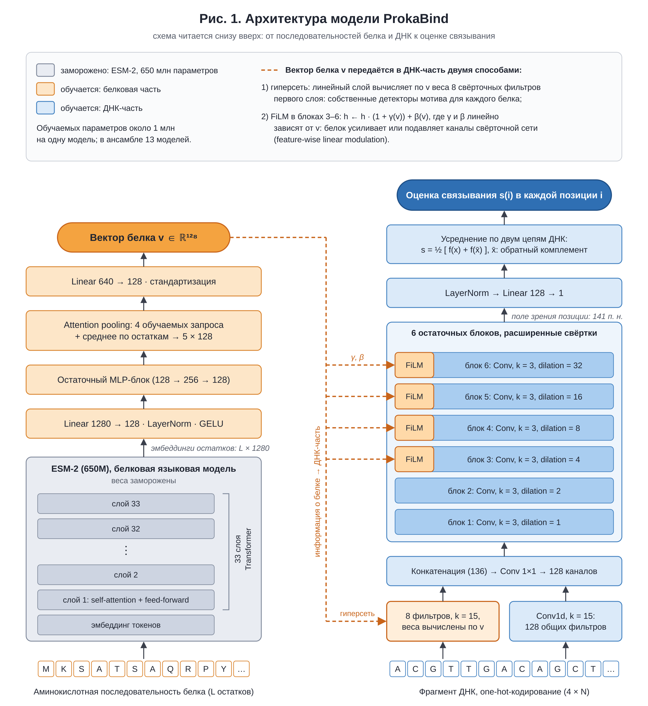
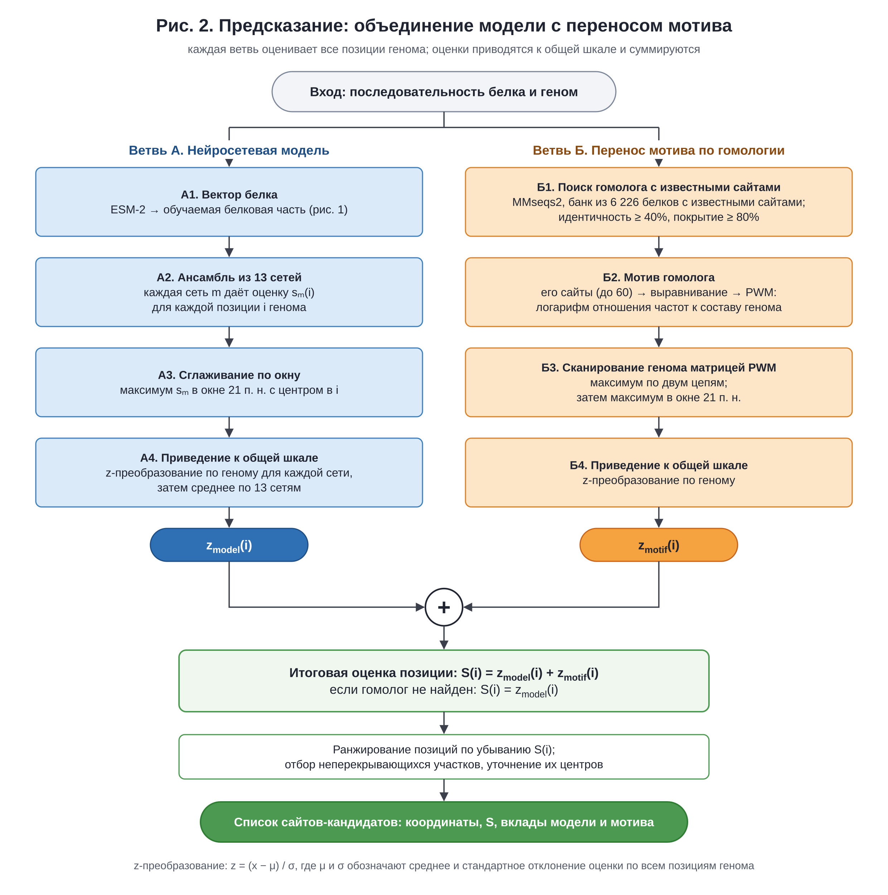

# ProkaBind

ProkaBind – программа для поиска сайтов связывания бактериальных транскрипционных факторов по аминокислотной последовательности белка.

ProkaBind получает аминокислотную последовательность транскрипционного фактора (ТФ) и последовательность генома, в котором нужно найти его сайты связывания. Результат – список участков ДНК, упорядоченных по оценке связывания: наиболее перспективные кандидаты стоят в начале списка. Метод объединяет нейросетевую модель, учитывающую последовательность исследуемого белка, и поиск по мотиву связывания его гомолога.

Практическая задача – выбрать участки для дальнейшей экспериментальной проверки. Оценка программы показывает приоритет кандидата в пределах данного генома.

Состояние на 11 ноября 2026 г. Рабочая версия модели проверена на контрольной выборке, используемой при разработке. Однократная итоговая проверка на отложенных данных ещё не проводилась (раздел 9), поэтому проект нельзя считать полностью завершённым.

Основной результат: на контрольной выборке из 46 белков, не участвовавших в обучении, ProkaBind лучше отличает известные сайты от фоновых участков ДНК, чем поиск только по мотиву гомолога.

| Белки | Перенос мотива | ProkaBind |
|---|---|---|
| С гомологом, идентичным не менее чем на 40% | 0,881 | 0,950 |
| Без такого гомолога | 0,633 | 0,801 |
| Все белки | 0,745 | 0,868 |

В качестве меры измерения точности предсказания выступает AUROC – показатель того, насколько хорошо метод ставит известные сайты выше фоновых участков. Значение 0,5 соответствует случайному упорядочиванию, 1,0 – полному разделению сайтов и фона. Это не доля верных предсказаний: например, AUROC 0,950 не означает, что 95% предложенных участков действительно связывают белок. Под гомологом здесь понимается белок из банка данных о сайтах; идентичность – доля совпадающих аминокислотных остатков в выравнивании. Условия сравнения и ограничения приведены в разделе 6.

## 0. Метод выполнения работы

Для написания кода проекта используется агентное программирование с моделями Claude. Я управляю агентом и принимаю основные решения. 

Для оценки своего реального вклада как человека я пробовал отправить свежего агента Claude выполнять проект в полностью автономном режиме с той же постановкой главной задачи и с той же основной архитектурой (использование модели ESM-2 и свёрточных нейросетей), автономная работа заняла около суток. В трёх слепых сравнениях, выполненных передовыми ИИ моделями разных компаний, вариант под моим руководством получил значительно более высокие оценки и я его продолжил развивать.

## 1. Биологическая задача

Для большинства бактериальных ТФ сайты связывания экспериментально не установлены. Если известна только последовательность белка, один из способов найти его предполагаемые сайты – использовать данные об изученном гомологе (перенос мотива по гомологии).

По известным сайтам гомолога строят мотив связывания – описание предпочтительных оснований в каждой позиции сайта. Затем в исследуемом геноме ищут последовательности, соответствующие этому мотиву. Для расчёта используют позиционную весовую матрицу (PWM): она позволяет присвоить каждому участку ДНК численную оценку сходства с мотивом.

Подход основан на предположении, что гомологичные ТФ узнают сходные последовательности ДНК. При высокой идентичности белков это часто оправданно, но надёжность подхода резко падает у белков с далёким родством. Если подходящего гомолога с данными о сайтах нет, перенести мотив невозможно.

Вопрос проекта: можно ли по последовательности самого белка предсказывать его сайты точнее, чем переносом мотива, – прежде всего при идентичности с изученным гомологом 40–70% и при отсутствии гомолога с идентичностью ≥ 40%?

## 2. Как модель учитывает белок и ДНК



Нейросетевая модель обрабатывает два вида последовательностей (рис. 1).

### Последовательность белка. 
Предварительно обученная модель ESM-2 преобразует аминокислотную последовательность в численные признаки (эмбеддинги). Эти признаки описывают каждый остаток с учётом его окружения в последовательности. Небольшая обучаемая сеть объединяет их в вектор из 128 значений. При обучении ProkaBind параметры самой ESM-2 не изменялись: белков с размеченными сайтами слишком мало для надёжного дообучения столь крупной модели. Если бы мы начали дообучать модель, то она бы слишком привыкла к белкам из тренировочного датасета, и это ослепило бы её по отношению к новым белкам.

### Последовательность ДНК. 
Вторая часть модели оценивает каждую позицию ДНК с учётом окружающего участка длиной 141 п. н. – по 70 п. н. с каждой стороны. Представление белка изменяет работу этой части сети: от него зависят как распознавание коротких последовательностей, так и последующая обработка их сочетаний. Таким образом, один и тот же участок ДНК может получать разные оценки для разных ТФ.

Оценки для прямой и обратно-комплементарной последовательностей усредняются. Поэтому результат не зависит от того, какая из двух цепей подана на вход.

Обучаемая часть одной сети содержит около 1 млн параметров. Её размер и длина учитываемого участка ДНК ограничены намеренно: при небольшом объёме данных это снижает риск переобучения, то есть запоминания обучающих примеров вместо выявления закономерностей, применимых к новым белкам и сайтам.

<details>
<summary>Технические подробности архитектуры</summary>

Белковая часть. Используется ESM-2 с 650 млн параметров и 33 слоями. Для каждого аминокислотного остатка берётся эмбеддинг последнего слоя размерности 1280. Далее следуют линейная проекция 1280 → 128, остаточный блок многослойной сети (MLP) и объединение признаков по остаткам: взвешенное агрегирование с четырьмя обучаемыми запросами (*attention pooling*) в сочетании с усреднением. Результат – вектор $v \in \mathbb{R}^{128}$, размерность которого не зависит от длины белка.

ДНК-часть. ДНК представлена четырьмя числовыми каналами, соответствующими A, C, G и T (*one-hot-кодирование*). Полносвёрточная сеть последовательно применяет к ДНК обучаемые фильтры: первый слой имеет ядро длиной 15 п. н. и 128 фильтров; за ним следуют шесть остаточных блоков с расширенными (*dilated*) свёртками с коэффициентами 1, 2, 4, 8, 16 и 32, затем линейный выходной слой. Рецептивное поле – участок ДНК, влияющий на оценку одной позиции, – составляет 141 п. н. Сеть выдаёт оценку $s(i)$ для каждой позиции $i$; длинный геном обрабатывается последовательными фрагментами.

Передача информации о белке в ДНК-часть реализована двумя механизмами:

1. Гиперсеть: линейный слой вычисляет по вектору $v$ веса восьми дополнительных фильтров первого слоя с ядром длиной 15 п. н. Эти фильтры зависят от исследуемого белка.
2. FiLM (feature-wise linear modulation): в блоках 3–6 значения внутренних признаков преобразуются по правилу $h \leftarrow h \cdot (1 + \gamma(v)) + \beta(v)$, где $\gamma$ и $\beta$ – линейные функции $v$. Представление белка задаёт масштаб и смещение этих признаков.

</details>

## 3. Как объединяются модель и мотив гомолога



Для каждого участка генома рассчитываются две оценки (рис. 2).

Нейросетевая оценка учитывает последовательность исследуемого белка. Для повышения устойчивости предсказаний используются 13 сетей одной архитектуры, обученных с разными случайными начальными значениями параметров. Такой набор сетей называется ансамблем; их оценки усредняются.

Оценка по мотиву гомолога показывает, насколько участок соответствует мотиву ближайшего подходящего белка из банка данных о сайтах. В банке 6 226 белков. Поиск выполняется программой MMseqs2; для переноса требуется идентичность ≥ 40% при покрытии выравниванием не менее 80% длины более короткой последовательности. По сайтам найденного гомолога и его почти идентичных вариантов строится PWM, которой оценивают обе цепи генома.

Перед объединением каждую оценку нормируют: выражают её превышение над средним по геному в единицах стандартного отклонения. Это приводит оценки к сопоставимой шкале. Их сумма даёт итоговую оценку S. Если подходящего гомолога нет, используется только оценка нашей модели.

Участки упорядочиваются по убыванию итоговой оценки S. В результат включаются неперекрывающиеся фрагменты длиной 21 п. н.; эта длина задаёт формат вывода и не означает, что биологический сайт всегда занимает ровно 21 п. н. Положение центра уточняется по мотиву гомолога, а при его отсутствии – по максимуму оценки ансамбля.

#### Зачем объединять два подхода
Модель использует последовательность самого белка, а перенос мотива – данные о сайтах гомолога. Эти источники информации могут дополнять друг друга. На контрольной выборке их сумма даёт лучший результат, чем каждый компонент отдельно (раздел 6). Равные веса позволяют обойтись без дополнительной подгонки коэффициентов. Проверенные альтернативы – неравные веса, максимум из двух оценок и метод Фишера – преимущества не показали.

Перенос мотива служит одновременно компонентом ProkaBind и самостоятельным методом сравнения: нужно проверить, даёт ли система преимущество перед использованием одного только мотива гомолога.

<details>
<summary>Технические подробности расчёта оценок</summary>

Нейросетевая оценка. Каждая сеть $m$ выдаёт оценку $s_m(i)$ для позиции $i$. Затем в окне шириной 21 п. н. выбирается максимум:

$$p_m(i) = \max_{|j-i| \le 10} s_m(j).$$

Это уменьшает влияние небольшой неточности в положении сайта. Оценки каждой сети стандартизуются, усредняются по ансамблю и повторно стандартизуются:

$$z_{\mathrm{model}}(i) = \mathcal{Z}\Big(\tfrac{1}{13}\sum_{m=1}^{13} \mathcal{Z}(p_m)\Big)(i), \qquad \mathcal{Z}(x)(i) = \frac{x(i) - \mu_x}{\sigma_x},$$

где $\mu_x$ и $\sigma_x$ – среднее и стандартное отклонение $x$ по всем позициям генома, для которых рассчитана оценка.

Оценка по мотиву. Используются сайты ближайшего гомолога и его вариантов с идентичностью ≥ 90%, всего не более 60 сайтов. Их выравнивают с подбором ориентации и строят PWM:

$$W_{k,b} = \ln\big(f_{k,b} / q_b\big),$$

где $f_{k,b}$ – частота основания $b$ в позиции $k$ с поправкой, предотвращающей нулевые частоты (псевдосчётом), а $q_b$ – доля этого основания в сканируемом геноме. Оценка позиции – наибольшая из оценок матрицы, центрированной на этой позиции, по двум цепям. Затем применяется такой же максимум в окне 21 п. н. и стандартизация по геному; результат обозначается $z_{\mathrm{motif}}(i)$.

Итоговая оценка:

$$S(i) = z_{\mathrm{model}}(i) + z_{\mathrm{motif}}(i).$$

Если подходящего гомолога нет, $S(i) = z_{\mathrm{model}}(i)$.

</details>

## 4. Как обучается модель

Известные сайты составляют лишь часть реальных сайтов в геноме. Поэтому неразмеченный участок нельзя уверенно считать участком, с которым белок не связывается. Модель обучают ранжированию: она должна ставить известный сайт выше участка сравнения, а не обязательно относить каждую позицию к категории «сайт» или «не сайт».

Для каждого сайта используются три типа сравнений:

1. Известный сайт и неразмеченный участок того же генома с близким GC-составом. Это мешает модели решать задачу только по нуклеотидному составу.
2. Сайт исследуемого белка и сайт другого белка. Оба участка оцениваются для исследуемого белка; его собственный сайт должен получить более высокую оценку.
3. Один и тот же сайт при подаче последовательности своего и постороннего белка. Более высокой должна быть оценка со своим белком. Это непосредственно требует от модели учитывать белковую последовательность.

В каждом шаге обучения используются 64 сайта разных белков: 60% – из экспериментальных баз и из базы BacRegDB кафедры молекулярной биологии, 40% – из RegPrecise. Обучение одной сети занимает 5–10 минут на видеокарте RTX 3090 или 4090. Сети ансамбля обучаются по одной схеме и различаются случайной инициализацией.

<details>
<summary>Технические параметры обучения</summary>

Обучение длится 2 000 шагов, длина входного фрагмента ДНК – 161 п. н. Оценка участка рассчитывается как сглаженный максимум (*log-mean-exp*) оценок его позиций. Функция потерь для пары – $\mathrm{softplus}(1 - (s^{+} - s^{-}))$, где $s^{+}$ – оценка, которая должна быть выше, а $s^{-}$ – оценка сравнения. Веса трёх типов сравнений – 1 : 1 : 0,5.

Используется оптимизатор AdamW и экспоненциальное скользящее среднее параметров сети (EMA), сглаживающее их изменения в ходе обучения.

</details>

## 5. Какие данные используются

Данные различаются по характеру доказательств: в проекте есть как результаты прямых экспериментов, так и сайты, предсказанные по мотивам или методами сравнительной геномики специалистами. Их роли разделены в таблице ниже. Из всех источников исключены сигма-факторы, белковые комплексы, кроме гомодимеров, и белки, связывающие ДНК только совместно с партнёром.

| Источник | Тип данных | Объём | Использование |
|---|---|---|---|
| CollecTF, RegulonDB 14.5 | сайты, подтверждённые in vitro с очищенным белком: футпринтинг, анализ сдвига электрофоретической подвижности (EMSA) | 2 948 сайтов, 454 белка, 147 организмов | обучение и оценка |
| PRODORIC | сайты из публикаций | 692 сайта, 173 белка | обучение |
| BacRegDB (курируемая часть библиотеки SigmoID) | операторы из профилей, проверенных куратором; преимущественно предсказания по мотивам | 18 171 сайт, 607 профилей | обучение; уточнение границ сайтов |
| RegPrecise 3.2 | регулоны, реконструированные методами сравнительной геномики | после фильтрации – 28 171 сайт, 7 851 регулятор | обучение |
| StrepTRN | пики DAP-seq, *Streptomyces coelicolor* | 68 419 пиков, 466 белков | оценка; в итоговую схему обучения не вошли |
| Коллекция Galagan | ChIP-seq, *Escherichia coli* | 132 белка | внешняя оценка |
| Trouillon et al., 2021 | DAP-seq, *Pseudomonas aeruginosa* PAO1 | 48 регуляторов | отложенная выборка для однократной итоговой проверки; при разработке не используется |

Для 210 сайтов экспериментальное подтверждение проверено вручную по первичным публикациям. Среди проверенных записей, отнесённых к футпринтингу, заявленное подтверждение удалось установить в 92% случаев.

Сайты RegPrecise обычно используют как набор коротких последовательностей, связанных с одним белком-представителем. Здесь каждый сайт сопоставлен с его положением в исходном геноме, дополнен фланкирующей последовательностью и связан с регулятором этого же генома. Для этого обработаны 15 218 страниц базы и дополнительно загружен 221 геном.

### Защита от попадания проверочных данных в обучение. 
Утечка данных может завысить качество, если модель уже встречала проверочный пример или очень близкий к нему. Для дополнительных источников действуют два основных ограничения:

- сайт исключается из обучения, если имеет общий отрезок длиной ≥ 12 п. н. с сайтом оценочной выборки;
- белок из дополнительного источника исключается из обучения соответствующей модели, если его идентичность с белком оценочной выборки составляет ≥ 40%.

Основная выборка разделяется по группам почти идентичных белков; это отдельное правило, описанное в разделе 6.1.

## 6. Насколько надёжны предсказания

### 6.1. Протокол оценки

#### Что измеряется
Метод должен отличать известные сайты белка от фоновых межгенных участков того же генома и той же длины. Основная метрика – AUROC: она характеризует упорядочивание сайтов относительно фона во всём диапазоне оценок. Для выбора небольшого числа кандидатов дополнительно оценивается, какая доля известных сайтов получает оценки выше 99% фоновых участков.

#### Как учитывается родство белков
Белки с идентичностью ≥ 90% объединены в 1 052 группы. Каждая группа целиком относится либо к обучению, либо к оценке: почти идентичный вариант проверочного белка не может попасть в обучение. Для итоговой оценки предусмотрена пятикратная перекрёстная проверка на 843 белках: данные делятся на пять частей, каждую из которых оценивает модель, обученная на остальных четырёх.

#### Как различаются условия предсказания.
Белки разделены по идентичности с ближайшим белком из датасета обучения: ≥ 70% – 89 белков; от 40% до < 70% – 217; < 40% – 537. Эти числа относятся к планируемой перекрёстной проверке, а не к контрольной выборке в таблице ниже.

#### Как усредняются результаты. 
AUROC сначала усредняется по парам «белок – геном», затем по белкам и группам гомологов. Группа служит единицей статистического анализа, поскольку близкие белки не являются независимыми наблюдениями. Для оценки неопределённости используется бутстреп – многократное повторное формирование выборки из этих групп. В квадратных скобках ниже приведены 95%-е доверительные интервалы.

#### С чем сравнивается модель. 
Обязательны сравнение с переносом мотива от ближайшего гомолога и контрольный вариант той же модели без информации о белке. Второе сравнение показывает, действительно ли аминокислотная последовательность помогает предсказывать сайты.

#### Проверка расчётов.
После каждого крупного этапа свежая ИИ-сессия, запущенная в терминале, пересчитывает результаты собственным кодом и проверяет данные на утечки/баги. По результатам финальной проверки утечек не выявлено.

Все результаты ниже получены на контрольной выборке: 46 белков из 40 групп гомологов, не участвовавших в обучении. Это предварительные данные. Основную проверку предсказательных способностей модели планируется запустить в ближайшее время.

### 6.2. Сравнение с переносом мотива

| Белки | Перенос мотива | Только модель | ProkaBind: модель + мотив | Преимущество ProkaBind по AUROC [95%-й ДИ] | Группы с улучшением |
|---|---|---|---|---|---|
| С гомологом ≥ 40% (19 групп) | 0,881 | 0,924 | 0,950 | +0,069 [+0,030; +0,114] | 16 из 19 |
| Без гомолога ≥ 40% (22 группы) | 0,633 | 0,801 | 0,801 | +0,169 [+0,061; +0,279] | 16 из 22 |
| Все (40 групп) | 0,745 | 0,857 | 0,868 | +0,122 [+0,057; +0,189] | 32 из 40 |

В строке «без гомолога ≥ 40%» ProkaBind использует только нейросетевую модель. Для самостоятельного метода сравнения перенос мотива выполнялся и от более отдалённого гомолога, с идентичностью 20–40%; если не было и такого, принималось случайное упорядочивание (AUROC 0,5). Одна группа представлена и в категории с гомологом и без, поэтому число групп в двух строках в сумме больше 40. 

### 6.3. Что даёт информация о белке

- Модель с белком превосходит вариант без информации о белке при одинаковом числе сетей в ансамбле. Преимущество по AUROC – +0,045 [+0,006; +0,083] на контрольной выборке и +0,050 [+0,019; +0,081] на 99 белках BacRegDB, выделенных для оценки при разработке.
- Если при оценке сайтов подать последовательность случайного белка, AUROC снижается в среднем на 0,21 [0,14; 0,29]. Это также указывает на то, что модель использует информацию о конкретном белке.
- Отбор наиболее перспективных участков: для белков с гомологом 50% известных сайтов получают оценки выше 99% фоновых участков; при одном только переносе мотива – 32%. Разница долей составляет +0,175 [+0,024; +0,347]. Если объединить перенос мотива с моделью без информации о белке, прибавка статистически неотличима от нуля: +0,056 [−0,032; +0,153].

### 6.4. Ограничения
- Не проводились замеры с основным замороженным проверочным датасетом.
- Высокий AUROC сам по себе не гарантирует надёжного короткого списка кандидатов. Для белков без гомолога ≥ 40% AUROC составляет около 0,80, но лишь около 13% известных сайтов получают оценки выше 99% фоновых участков. У переноса мотива 8%; необходимо тестирование на полном замороженном наборе, чтобы быть уверенными в победе над переносом мотива.

## 7. Пример: поиск сайтов NifA

Белок. NifA – активатор генов азотфиксации, узнающий последовательности вида TGT‑N₁₀‑ACA перед их промоторами. В примере используется последовательность NifA из *Azorhizobium caulinodans*. Этот белок не входил в обучение; его идентичность с ближайшим белком в банке данных о сайтах составляет 46%.

Геном. Поиск проводится в геноме другого вида – *Rhodospirillum centenum* SW (4,4 млн п. н.). Таким образом, пример демонстрирует поиск предполагаемых сайтов родственного регулятора с использованием белка из другого организма. В BacRegDB для этого генома аннотировано семь сайтов NifA (`examples/known_NifA_sites_BacRegDB.tsv`). Ни один из них не имеет общих отрезков длиной ≥ 12 п. н. с обучающими сайтами какого-либо белка.

Первые строки списка кандидатов по всему геному (`examples/expected_NifA_top50.tsv`):

| Ранг | Начало участка | Итоговая оценка $S$ | Вклад модели | Вклад мотива | Совпадение с аннотированным сайтом NifA | Ближайший ген |
|---|---|---|---|---|---|---|
| 1 | 3 822 601 | 14,2 | 7,4 | 6,8 | да | *nifV* (гомоцитратсинтаза) |
| 2 | 3 815 548 | 13,7 | 6,9 | 6,8 | да | *nifH* (редуктаза нитрогеназы) |
| 3 | 3 822 637 | 12,8 | 7,3 | 5,5 | да | *nifV* |
| 4 | 509 695 | 12,1 | 6,3 | 5,9 | да | ген сборки Fe–S-кластеров |
| 5 | 3 820 055 | 11,6 | 5,8 | 5,8 | да | *nifB* (биосинтез FeMo-кофактора) |
| 6 | 509 731 | 11,5 | 5,0 | 6,5 | да | *nifQ* |
| 7 | 241 774 | 11,5 | 6,5 | 5,0 | – | – |
| 8 | 2 947 496 | 10,4 | 6,6 | 3,9 | – | гипотетический белок |

Координаты начала участков приведены как в выходном файле, с нумерацией от нуля. Вклады модели и мотива – стандартизованные оценки $z_{\mathrm{model}}$ и $z_{\mathrm{motif}}$, описанные в разделе 3. Прочерк означает отсутствие совпадения с аннотацией и сам по себе не доказывает, что участок не связывает NifA.

Шесть из семи аннотированных сайтов соответствуют первым шести строкам списка, полученного при поиске по всему геному; седьмой не вошёл в первые 50. При отключении переноса мотива (`--no-motif`) пять из семи сайтов получают ранги 1, 2, 4, 9 и 19 (`examples/expected_NifA_top50_model_only.tsv`).

## 8. Как запустить прототип программы

Требуются Python ≥ 3.10 и [MMseqs2](https://github.com/soedinglab/MMseqs2) для поиска гомолога.

```bash
git clone <адрес репозитория> prokabind && cd prokabind
python -m venv .venv && source .venv/bin/activate
pip install torch --index-url https://download.pytorch.org/whl/cpu # PyTorch для центрального процессора
pip install -r requirements.txt
conda install -c bioconda mmseqs2 # или: apt install mmseqs2 / brew install mmseqs2
```

Воспроизведение примера из раздела 7:

```bash
python predict.py --protein examples/NifA_Azorhizobium_caulinodans.fasta \
                  --genome examples/Rhodospirillum_centenum_SW_CP000613.2.fasta \
                  --circular --top 50 --out nifA_sites.tsv
```

Здесь `--circular` указывает, что последовательность генома кольцевая, `--top 50` задаёт число кандидатов, а `--out` – имя выходного файла. Время расчёта на ноутбуке – около 20–30 минут для 13 сетей и генома длиной 4,4 млн п. н. Видеокарта не обязательна; параметр `--device cuda` позволяет использовать совместимую видеокарту NVIDIA для ускорения. Результат должен совпасть с `examples/expected_NifA_top50.tsv`.

Для другого белка параметру `--protein` передают файл FASTA с одной аминокислотной последовательностью или саму последовательность; параметру `--genome` – файл FASTA с геномом. Признаки ESM-2 для нового белка вычисляются один раз и сохраняются для повторного использования. При первом таком запуске загружаются веса ESM-2 (около 2,5 ГБ). Для белка из примера признаки уже находятся в `cache/esm2`. Параметр `--no-motif` отключает перенос мотива.

Результат сохраняется как текстовая таблица с разделением столбцов табуляцией (TSV):

| Столбец | Значение |
|---|---|
| `replicon` | идентификатор хромосомы или плазмиды |
| `start`, `end` | начало и конец предсказанного участка: нумерация от нуля, конечная позиция не включена |
| `score` | итоговая оценка $S$, по которой упорядочены кандидаты |
| `ensemble_z` | стандартизованный вклад нейросетевой модели |
| `motif_z` | стандартизованный вклад мотива гомолога; пусто, если мотив не использовался |
| `centre_by` | способ уточнения центра: `motif` – по мотиву гомолога, `ensemble` – по оценке ансамбля |
| `sequence` | последовательность предсказанного участка |

## 9. Будущие шаги 


1. Обучить модели для пятикратной перекрёстной проверки и однократно оценить качество на 843 белках и на отложенной выборке *P. aeruginosa*. По протоколу эти результаты не используются для последующей настройки модели, поэтому проверка выполняется после завершения разработки.
2. При необходимости внести правки.

## 10. Состав репозитория и воспроизводимость

| Путь | Содержание |
|---|---|
| `predict.py` | запуск предсказания: белок + геном → таблица предполагаемых сайтов |
| `models/dev_v3/` | веса 13 сетей и банк данных о сайтах для переноса мотивов |
| `src/prokabind/model.py` | архитектура сети (рис. 1) |
| `dev/predictor.py` | схема предсказания (рис. 2): поиск гомолога, оценка генома ансамблем, объединение оценок |
| `lib/eval_defs.py` | построение PWM, поиск по мотиву и определения метрик |
| `dev/dense/train_dense.py` | обучение |
| `dev/dense/` | оценка качества по AUROC, сравнение с переносом мотива при разной идентичности белков |
| `dev/regprecise/` | обработка RegPrecise: получение сайтов в геномном контексте и подготовка обучающей выборки |
| `src/prokabind/` | остальные модули: получение признаков белка, обработка генома и др. |
| `examples/` | пример: белок, геном и ожидаемый результат |
| `docs/` | рисунки и политика данных |

Репозиторий позволяет запустить готовую модель и воспроизвести пример. Для воспроизведения обучения и оценки качества требуются полные исходные таблицы, которые сюда не включены.

Банк данных о сайтах содержит последовательности из источников обучения: CollecTF, RegulonDB, PRODORIC, BacRegDB, SigmoID и RegPrecise. Данные включены только для ознакомления и проверки модели и не предназначены для дальнейшего распространения.

